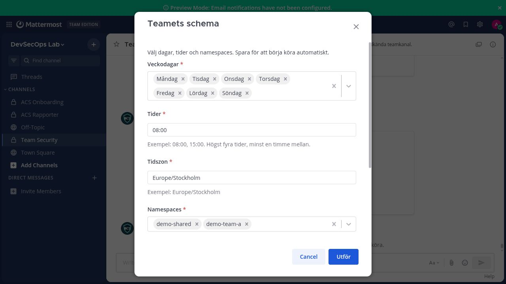
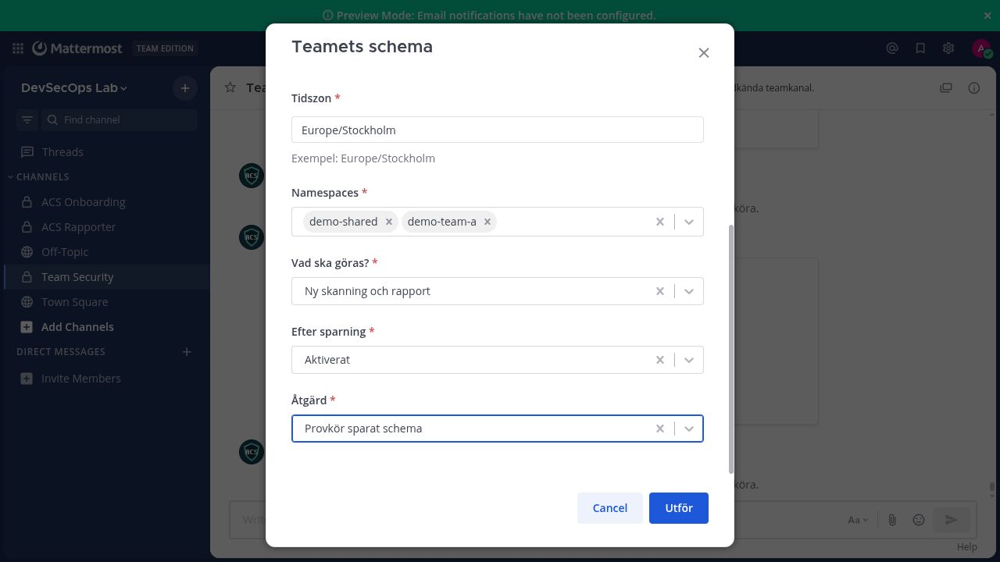
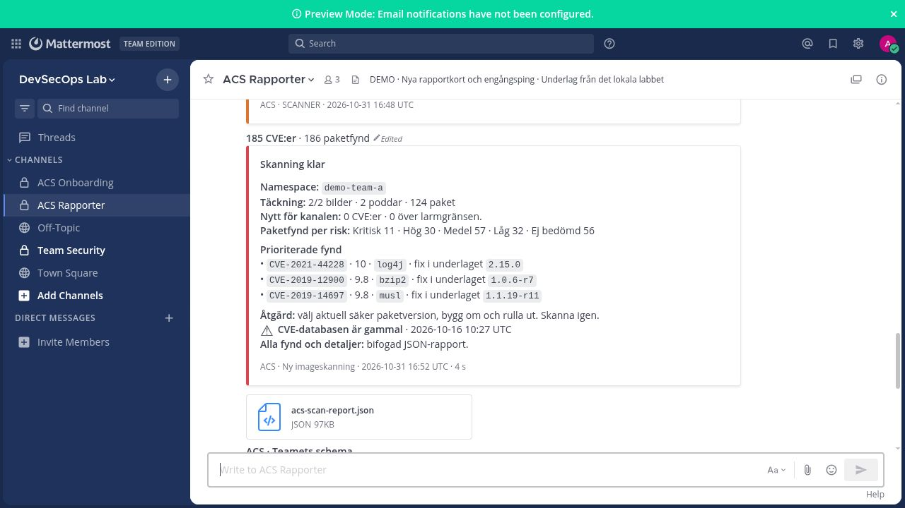

# Privat installation · CVEBridge i Go

Det här är leveransen för din egen OpenShift-installation. Den innehåller Go-kod,
Dockerfile, en ifyllbar `.env.example`, manifestgenerator, installationsguide och
skärmbilder. Den ska stanna i det privata repot. Skriv inte företagets tokens,
adresser eller interna skärmbilder i det publika repot eller i LinkedIn-texten.

## Ditt flöde

```sh
oc login https://api.DITT-LABB:6443
oc project cvebridge
./cvebridge.sh init
# Fyll i CHANGE_ME och kontrollera serviceadresserna i .env.
./cvebridge.sh build
./cvebridge.sh push
./cvebridge.sh render

# Plattformsteamet granskar och applicerar bootstrap en gång.
oc apply -f deploy/generated/bootstrap.yaml
oc apply -f deploy/generated/deployment.yaml
oc rollout status deployment/cvebridge
```

Deployment använder automatiskt
`image-registry.openshift-image-registry.svc:5000/NAMESPACE/cvebridge:TAGG`.
Pushen använder den externa routen som skriptet hämtar från klustret. Inga företagsvärden byggs in i imagen.
Tokens tillförs via Kubernetes Secret. `.env` och genererade filer är git-ignorerade.
`deployment.yaml` innehåller hemligheter och ska behållas privat, även när du delar
vanlig projektkod. `bootstrap.yaml` kräver mer behörighet än vanlig namespace-admin;
SubjectAccessReview måste godkännas på klusternivå en gång.

Den fullständiga fältguiden, nätverkskraven, Mattermost-kommandot, reporterrollen,
registry-secret och felsökning finns i [START_HAR.md](START_HAR.md).
[Driftguiden](docs/DRIFT.md) beskriver uppgradering, state och migration från Python.
[Fältguiden för .env](docs/ENV_VARDEN.md) visar ifyllda exempel och var du får tag
på adresser, ID:n och varje separat token.

## Kontrollera i Mattermost

Boten nås via `http://cvebridge-webhook.NAMESPACE.svc:8001`. Ingen extern Route
skapas i standardinstallationen; Mattermost måste kunna nå denna Service.

Bjud in en icke-administrativ bot till den godkända privata kanalen och registrera
`/cve` enligt guiden. Vanliga teammedlemmar kan sedan köra `scan`, söka en CVE och
öppna `schedule` direkt i Mattermost. Det finns ingen separat webbapp i Go-versionen.







Bilderna är referenser från det tidigare riktiga Mattermost-labbet. Go-portens
manuella skanning, CVE-sökning och native provkörning har också testats mot labbets
riktiga Mattermost och StackRox. Ingen företagsinstallation i OpenShift är ännu
verifierad; gör en riktig skanning i ditt eget labb efter installationen.

## Operator?

Den här versionen använder en vanlig Deployment med en replika och PVC.
En operator kan införas senare om ni behöver egna CRD-resurser och automatisk
hantering av flera installationer. Det behövs inte för ditt nuvarande arbetsflöde.
