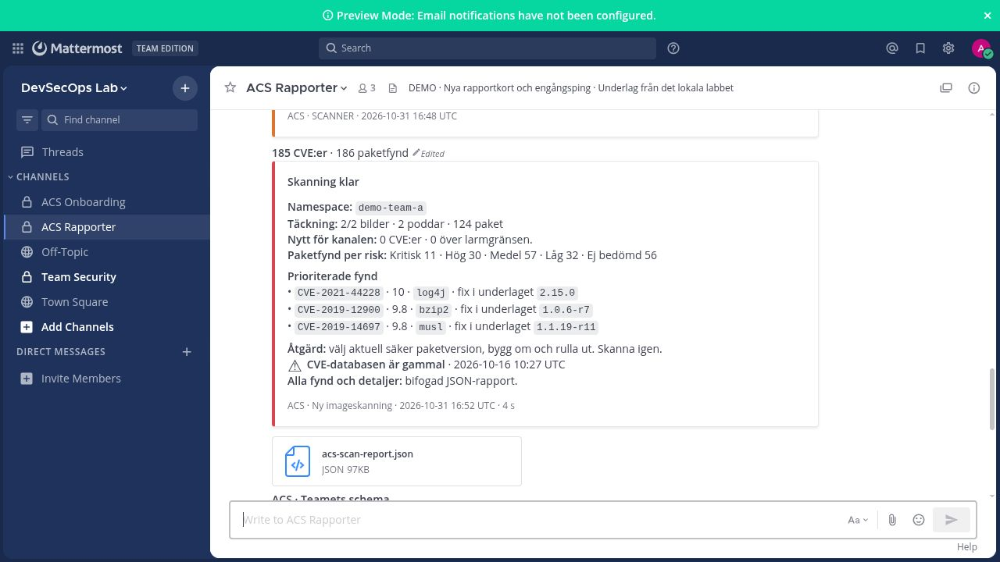
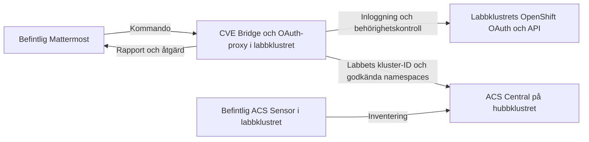
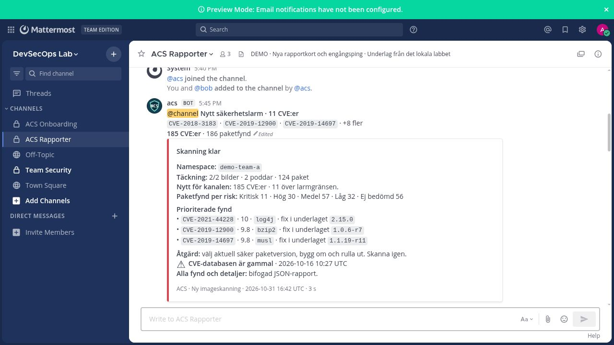
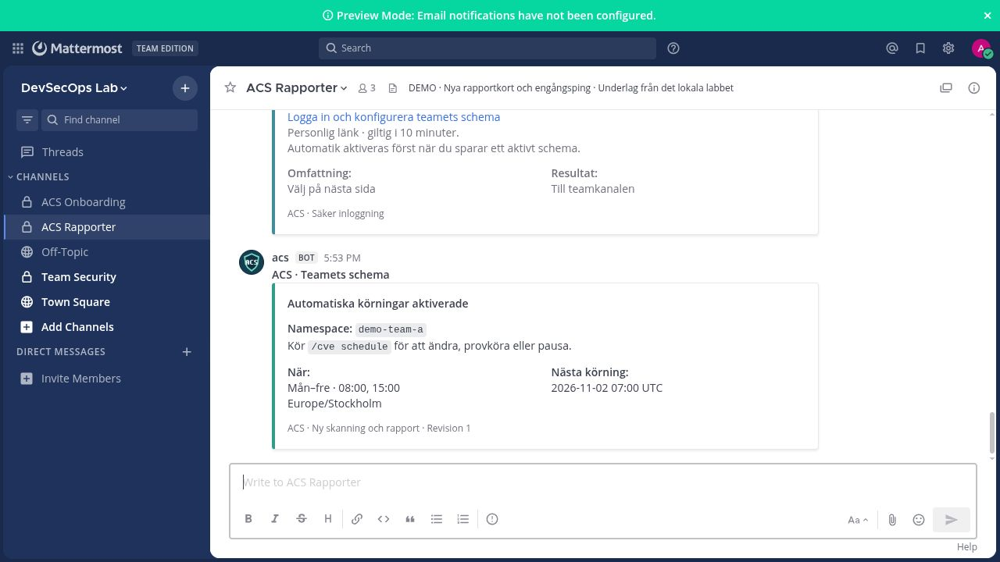

# CVE Bridge — privat OpenShift-installation

Det här är din privata leverans för ett separat **privat GitHub-repo**.
Den innehåller appens källkod, generiska konfigurationsexempel och din privata
installationsguide. Verkliga lösenord, token och klusterkonfigurationer ingår inte.

## Så ser rapporten ut

Kortet visar risknivåer, prioriterade fynd, åtgärd och länken till hela rapporten.
Bilden kommer från den verifierade lokala installationen med k3d och Dex.
OpenShift-installationen i ditt labbkluster är ännu inte genomförd.



## Placering i ditt OpenShift-labb

Appen installeras i labbklustret och använder dess inloggning och behörigheter.
Den hämtar skanningsunderlaget från befintlig ACS Central på hubbklustret.



## Börja här

1. Ladda ner eller klona [det privata repot](https://github.com/SmidraClawd/cvebridge-openshift-private) på datorn som når ditt labbkluster.
2. Läs [den privata installationsguiden](PRIVAT_INSTALLATION.md). Den beskriver
   förberedelser, OpenShift-inloggning, hubbens ACS Central och installation i labbet.
3. Skapa din lokala konfiguration från projektroten:

   ```bash
   python3 scripts/company.py init --file .local/company.json
   ```

4. Fyll i adresser, kluster-ID och befintliga tjänsters uppgifter i den lokala
   konfigurationen. Bygg och publicera app-imagen i ditt godkända register enligt guiden.
5. Kontrollera och förbered installationsfilerna:

   ```bash
   python3 scripts/company.py check --file .local/company.json
   python3 scripts/company.py prepare --file .local/company.json
   ```

6. Granska resultatet och använd guidens `oc --context ...`-kommandon för att
   installera i avsett labbkluster. Kommandona ovan gör inga klusterändringar.

**Status:** den lokala k3d-demonstrationen och resursgenereringen är testade.
Riktig OpenShift OAuth och installation i ditt labbkluster är ännu inte verifierade.

## Engångslarm och automatiska rapporter

**Engångslarm:** i demonstrationen får kanalen en `@channel`-mention för fynd
över larmgränsen. Bilden visar alternativet att pinga redan i första rapporten;
standardinställningen skapar först ett utgångsläge utan ping.



**Teamschema:** teamet väljer dagar, tider, tidszon och godkända namespaces.
Boten bekräftar inställningarna i kanalen.



Alla bilder ovan visar det lokala labbet. Se [hela bildguiden](LOKALT_LABB.md)
för beställning, inloggning, CVE-sökning, fel och körhistorik, och
[den privata installationsguiden](PRIVAT_INSTALLATION.md) för OpenShift-stegen.
Den publika GitHub-versionen och LinkedIn-texten distribueras separat.
