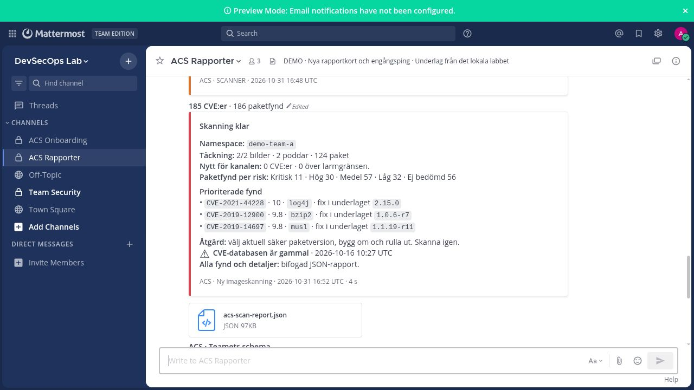
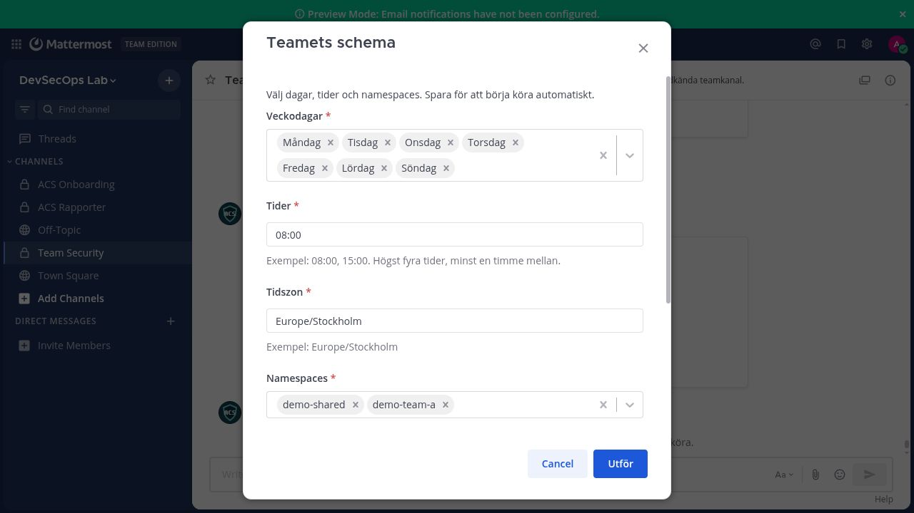
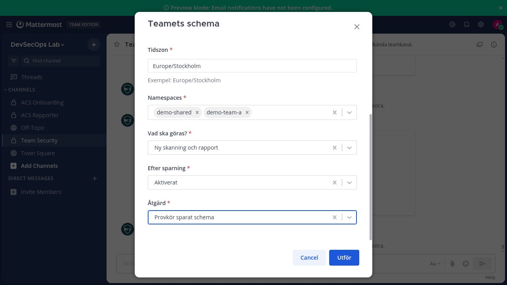
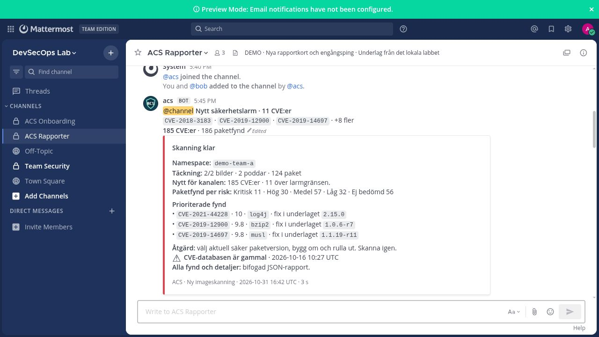

# Så ser det ut i Mattermost

Referensbilder från det tidigare lokala labbet. Den aktuella Go-boten använder
samma rapport- och formulärprinciper; installationen i ditt labb behöver verifieras där.

## Skanningsrapport med Åtgärd

## Schema direkt i Mattermost

## Första kritiska larmet

